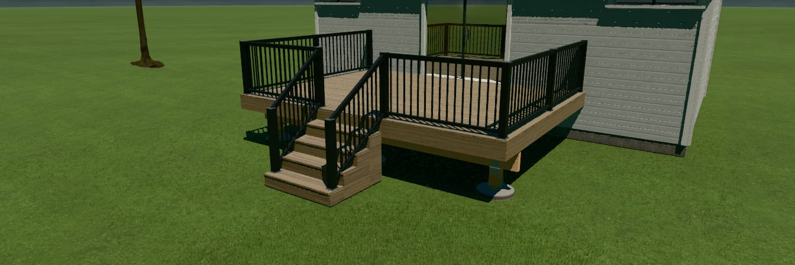
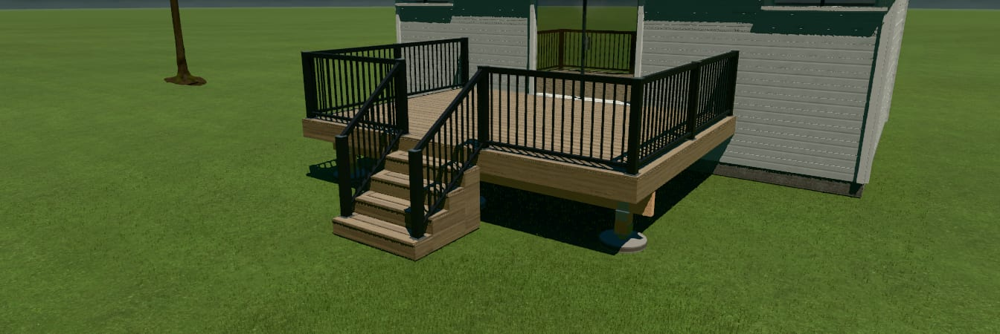
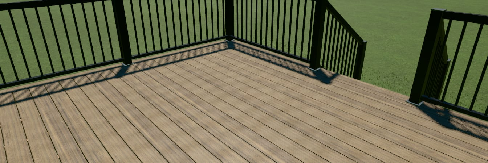
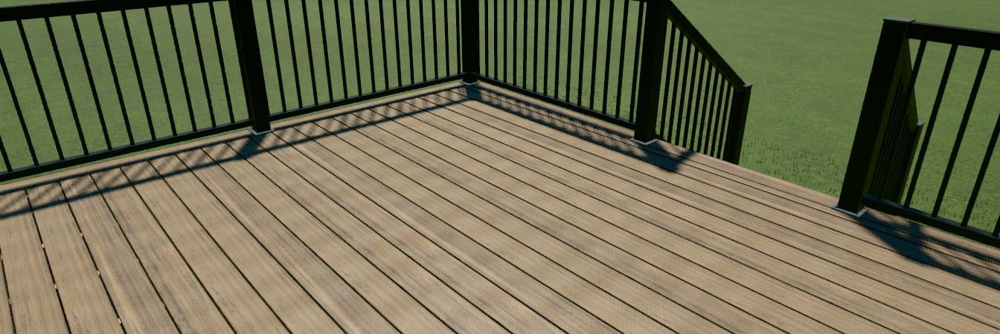

# Deck board realism — before and after (2026-10-30)

The owner installed the DeckCraft desktop app and said the deck "has horrible graphics": in 3D the boards read as one
smooth slab. These renders compare branch `feat/deckcraft-board-realism` with main at fixed cameras:

- the default deck (TimberTech Harvest Brownstone);
- a Deckorators Voyage Costa deck.

They came from a local dev server on port 3011, rendered by headless Edge on the RTX 5070 (ANGLE D3D11) at render
quality `high`, with Realistic look on.

| | Before (main 93e87831) | After |
|---|---|---|
| Harvest, Corner preset |  |  |
| Harvest, close deck view |  |  |
| Costa, Corner preset |  |  |
| Costa, close deck view |  |  |

The close camera is a saved camera: `{positionIn:[40,90,24], targetIn:[150,28,120], fov:38}`.

## What changed (finished board pieces only)

- **One tone per board.** A board course keeps one strip of its photo for its whole length. Every 48 in the grain
  slides to a new offset, with a short crossfade. Each board starts its tiles at its own seed, so the handovers never
  line up across the deck. Grain correlation from one 48 in tile to the next is −0.03; a single repeated strip would be 1.
- **Board edges.** The long edges shade into the gap over about ¼ in, and the shading is never thinner than one pixel.
  At mid distance the 3/16 in gap goes sub-pixel and would break into dots, so there the line darkens (0.62 → 0.30) and
  carries the board line unbroken. The shade is mean-normalised, so the product colour is unchanged. The edge also
  goes matte inside that band.
- **Fascia in its boards.** Each rim run shows the 12 ft boards the estimate prices. They are split evenly, with no
  sliver at a corner, and butted with a ⅛ in gap. The mitres stay exactly at the corners, and each board has its own
  grain. A selected manufacturer fascia is split the same way.
- **Shape.** Boards have a real ⅛ in eased edge, with 2 segments.
- **Gaps.** A near-black cavity sits under each decked level's own outline. It:
  - never shows past the deck edge;
  - is left off boardless winder levels;
  - is one-sided;
  - takes no snow;
  - lets clicks through.
- **Photo handling.** The high render tier reads swatch photos at up to 2048 px. Board strips that the photo's edge
  cuts short are dropped.
- **Bundle.** The atlas builder now loads lazily for the main-thread fallback, so it leaves the 3D viewer chunk
  (337.9/340 KB, down from 339.8).
- **Unchanged:** apart from the fascia joints, the fascia's surface look, cladding, skirting, raised-bed timbers,
  stringers and the box-projected framing look exactly as before.

## Blind critic scores (deck boards only, 1–10)

The critics were not told which image was which. Two critics (Opus and Sonnet) scored each round.

| Final code | Close: before → after | Corner: before → after |
|---|---|---|
| Harvest, round 8 | 6 → 7, 6 → 7 | 5 → 5, 6 → 5 |
| Harvest, round 9 (same code) | 7 → 6, 6 → 6 | 6 → 6, 5 → 5 |
| Costa, round 9 | 6 → 7, 7 → 7 | 6 → 6, 5 → 5 |
| Harvest, round 10 (+ solid mid-distance lines, fascia boards) | 6 → **7**, 5 → 5 | 5 → **6**, 4 → 4 |
| Costa, round 10 | 6 → **7**, 6 → 6 | 5 → **6**, 5 → 5 |

The Harvest code is identical in rounds 8 and 9, so the scores move about ±1 by chance.

Round 10 is the first clear result. The deck-builder critic picked the new render in all four pairs and gave the reason
each time: its gaps "render as continuous lines" where the old ones break into dots. The second critic called the pairs
ties or a marginal edge for the new render.

What changes in the renders:
- crisper, darker gap lines;
- board lines that hold at mid distance;
- no visible grain repeat along a board;
- no tone patches within a board.

## Sharper photos: tried, measured, not used

With the owner's OK, 15 Deckorators colours were tried with Deckorators' own 1000–2000 px installed close-ups (cited
URLs, mirrored, and colour-matched to the official chip within ΔE 0.6). Up close they rendered clearly worse than the
official 600 px colour chips:
- 4–5 against 7, across two critic rounds;
- with the grain at its real scale (about 11 in per photo) and at the 48 in stretch alike;
- critics' words included "motion-blurred static".

They were reverted. TimberTech publishes nothing larger at board scale: its 1000 px "Detail Swatch" photos are macro
shots of about 3 in of one board.

## What still holds it back (critics' consensus)

- **Grain:** soft and low-contrast up close. 59 of 60 swatches are 600 px or smaller.
- **Fascia joints:** a ⅛ in joint is sub-pixel in these views, as it would be in a photo. The fascia and stair skirts
  still read as flat, low-contrast faces.
- **Stairs:** jagged dark "icicle" streaks under the tread nosings. This is shadow aliasing and predates this branch.
- **Rim edge:** a dotted bead along the rim's top edge, which is the board ends' gaps seen end-on. It predates this
  branch.
- **Harvest colour:** a little uniform from board to board.
