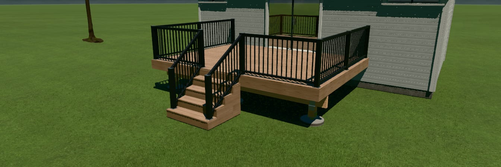
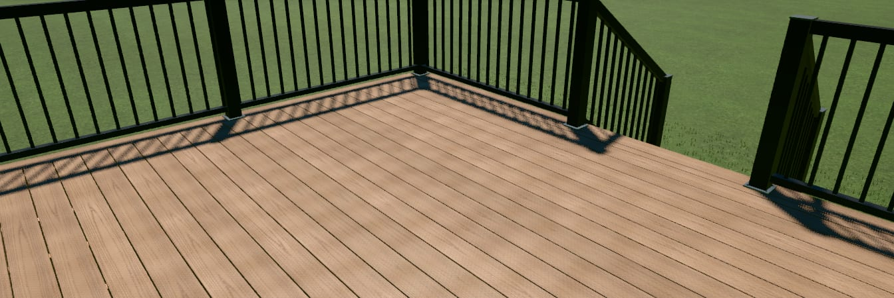

# Deck board realism — before and after (2026-10-30)

The owner installed the DeckCraft desktop app and said the deck "has horrible graphics": in 3D the boards read as one
smooth slab. These are the default deck (TimberTech Harvest Brownstone) before and after branch
`feat/deckcraft-board-realism`, at fixed cameras, from a local dev server on port 3011. The renders came from headless
Edge on the RTX 5070 (ANGLE D3D11) at render quality `high` with Realistic look on.

| | Before (main 93e87831) | After |
|---|---|---|
| Corner preset |  |  |
| Close deck view |  |  |

The close camera is a saved camera, `{positionIn:[40,90,24], targetIn:[150,28,120], fov:38}`.

## What changed

- The grain changes strip and offset every 48 in along a board, with a short crossfade. Long boards no longer repeat one
  stretch of grain: the tile-to-tile correlation is −0.03, where one repeated strip scores 1.
- Each board's long edges shade into the gap over about ¼ in. The line is never thinner than a pixel, and the shade is
  normalised so the board's mean colour stays the product's. Board lines therefore hold in the Corner view.
- Boards have a real ⅛ in eased edge, with 2 segments. Cut pieces such as mitres get the same bevel.
- A near-black cavity sits under each decked level's outline, so the gaps read dark. It never sticks out past the deck
  edge, takes no snow, and is invisible from under the deck.
- The high tier reads swatch photos at up to 2048 px for its 2048 atlas.
- Fascia, cladding, skirting, raised-bed timbers, stringers and the box-projected framing look exactly as before.

## Blind critic scores

Independent critics were not told which image was which. They scored only the deck boards, from 1 (smooth slab) to 10
(photo).

| Round | Critic | Close: before → after | Corner: before → after |
|---|---|---|---|
| Final | deck-builder critic (Opus) | 6 → **7** | 6 → 5 |
| Final | render critic (Sonnet) | 5 → **6** | 5 → 5 |

Both critics prefer the after image in the close view. In the Corner view one calls the pair a tie and the other
prefers the before image. They read the stair tread border seams as an "inset outline", and the board lines alias into
dots at a distance.

Earlier rounds found two regressions, now fixed: a dark fringe under tread nosings and a cavity over winder treads.

## What still holds it back

Both critics say the grain is soft and low-contrast up close. The cause is the source photos, not the renderer:
- 59 of 60 swatches are 600 px or smaller. The default Harvest swatch is 480 px.
- TimberTech publishes nothing larger at board scale. Its 1000 px "Detail Swatch" photos are macro shots of about 3 in
  of one board, so as board texture the grain would come out about 10× too big.
- Deckorators publishes 1000–2000 px multi-board close-ups for 17 colours. Downloading them is waiting on the owner's OK.

The check `check-deck-realism` keeps a low-res list that only shrinks as photos are replaced.
